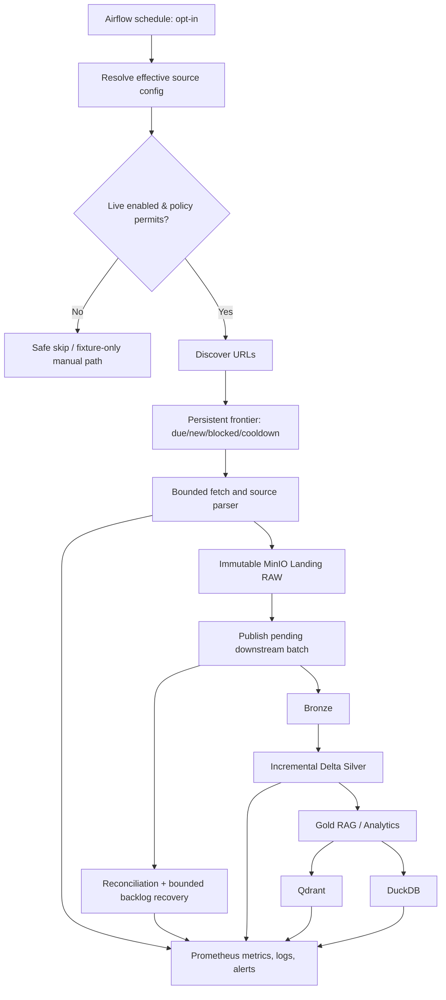

# Phase 09 — Continuous Local Crawling, Scheduling, Burn-in & Autonomous Operations

> **Loại tài liệu:** Engineering implementation plan / AI coding-agent task specification  
> **Dự kiến đặt tại repo:** `docs/agent_tasks/09-continuous-local-crawling-scheduling-burnin.md`  
> **Phạm vi:** Financial-news data processing platform — **local only**  
> **Đầu vào:** `CHAT_CONTEXT_HANDOVER_LATEST.md` và bằng chứng mới nhất trong repository  
> **Trạng thái:** **PLANNED — chưa xác nhận triển khai Phase 09**  
> **Nguyên tắc:** Repo hiện tại và test/log thật là source of truth; số liệu trong handover chỉ là snapshot lịch sử.

---

## 0. Executive summary

Phase 08 đã được báo cáo là **PASS local acceptance** với crawler cho 5 nguồn: **CafeF, VnExpress, Tuổi Trẻ, Thanh Niên, Báo Mới**. Crawler đã đi qua Landing → Bronze → Silver → Gold → Qdrant/DuckDB trên một tập live E2E nhỏ. DAG được báo cáo là `news_crawling_pipeline`, gồm 5 nhóm `crawl → publish` (10 tasks), nhưng `schedule = None` và manual default dùng fixture.

**Mục tiêu Phase 09:** chuyển từ **manual, successfully validated** sang **scheduled, observable, recoverable, unattended local operation**, đồng thời có **evidence thực nghiệm** đủ dùng cho báo cáo/đồ án. Phase này **không** chứng minh production readiness, không mặc định chứng minh high throughput và **không** triển khai Azure.

### Definition of Done (DoD) cấp phase

- [ ] Có kết quả repo preflight và ghi rõ sai khác so với handover (nếu có).
- [ ] Có cơ chế bật/tắt live schedule **opt-in**, giữ nguyên manual fixture mode, không tạo live traffic ngoài ý muốn.
- [ ] Schedule có thể cấu hình, `catchup=False`, concurrency có giới hạn, không chạy chồng chéo ngoài kiểm soát.
- [ ] Cấu hình/chính sách từng source được áp dụng ở runtime, tách rời cách Airflow lên lịch DAG.
- [ ] Incremental/frontier, content-change, idempotency và downstream retry tiếp tục đúng như Phase 08/05.
- [ ] Quan sát được success/failure, parser/layout drift, freshness, backlog, độ trễ và tăng trưởng tài nguyên theo source.
- [ ] Có failure-injection/recovery test, không gây mất dữ liệu hay tạo duplicate ngoài contract.
- [ ] Chạy burn-in **24 giờ thật**, đánh giá kết quả; sau đó **72 giờ thật** nếu đạt go/no-go gate; 7 ngày là tùy chọn.
- [ ] Có `phase9-acceptance` (hoặc entrypoint tương đương phù hợp repo), report, evidence và runbook.
- [ ] Regression các phase liên quan vẫn PASS; không sửa canonical contract ngầm và không làm suy giảm cơ chế cloud security gate.

---

## 1. Current baseline — chỉ là thông tin từ handover

| Hạng mục | Last reported state | Điều kiện xác nhận |
|---|---|---|
| Branch | `feature/multisource-news-crawler` | `git branch --show-current` |
| Phase 08 | `make phase8-acceptance` PASS, exit 0 | Chạy lại khi môi trường cho phép |
| Git tree | 15 tracked modified, 58 untracked, 0 staged | `git status --short`, `git diff --stat` |
| Crawl sources | CafeF, VnExpress, Tuổi Trẻ, Thanh Niên, Báo Mới | Inspect adapters/config/tests |
| Crawler DAG | `news_crawling_pipeline`, 10 tasks | Inspect DAG + Airflow DAG parse |
| Schedule | `None` | Inspect DAG + scheduler env/config |
| Crawl state | PostgreSQL `crawler_operations` | Inspect migration/query/state transitions |
| Source config | `control_metadata.news_sources.config` | Inspect actual JSON structure/version |
| RAW Landing | MinIO stores HTML and source-specific payload | Inspect object layout + manifest |
| Crawler defaults | 3s/request; timeout 20s; max 20 articles/batch; recheck 6h; recent window 7 days | Inspect actual runtime config |
| Monitoring | 7 dashboards, 15 alert rules reported overall | Inspect monitoring assets/current dashboards |
| Issue | Intermittent S3 HTTP 400; cause unknown | Capture evidence if recurs |
| Security | Historical credential in Git history; cloud release **NOT READY** | Verify security status; keep cloud gate blocked until resolved |

**Không tự coi các giá trị ở bảng trên là kết quả kiểm chứng hiện tại.** Nếu thực tế khác, ghi discrepancy trong phần báo cáo và điều chỉnh kế hoạch theo repo/test mới hơn.

---

## 2. Scope, non-goals, architectural invariants

### 2.1 In scope

1. Controlled Airflow scheduling for current crawler DAG.
2. Runtime configuration and per-source policies; safe live/fixture gating.
3. Incremental crawl execution and bounded per-source concurrency.
4. Source health / parser drift classification and alerting.
5. Backlog visibility, replay, retry, reconciliation and operational recovery.
6. Freshness/latency metrics for Landing, Silver, Gold, Qdrant, DuckDB.
7. Local dashboards, alert tuning, daily operational report and runbook.
8. Deterministic tests, controlled failure-injection, 24h/72h burn-in evidence.

### 2.2 Out of scope

- Azure/ADLS/AKS migration, Terraform cloud rollout, cloud cost/performance benchmark.
- Chuyển Kafka thành news/article event queue; stock streaming/Flink/BI branch.
- Thay Airflow, MinIO, Spark/Delta, PostgreSQL, Qdrant hoặc DuckDB chỉ vì Phase 09.
- Thay đổi canonical data contract, phát minh thêm ticker/NER/sentiment/event metadata khi không có nguồn/cơ chế hợp lệ.
- Crawl khối lượng lớn ngay từ đầu, vượt rate limit, vượt robots/site policy hoặc né anti-bot controls.
- Xây unified multi-source serving facade hoặc frontend/RAG application nếu chưa có yêu cầu riêng.
- Tự ý rewrite Git history/rotate credential như một phần của scheduler work; đó là **security workstream riêng**.

### 2.3 Non-negotiable invariants

- Five source-specific raw contracts/adapters → **canonical boundary giữ ổn định**.
- Landing lưu raw evidence/replay; unchanged article → **không tạo downstream batch mới**.
- Changed article → update batch; failed downstream batch → replay từ persisted data, **không bắt buộc refetch website**.
- Airflow orchestration, transformation/recovery logic có thể chạy độc lập.
- PostgreSQL `control_metadata`/`crawler_operations` là control/operations plane; Kafka chỉ làm metadata CDC.
- Qdrant/DuckDB là serving derivatives có thể rebuild từ Gold.
- Metrics/labels không đưa `url`, `article_id`, `run_id` thành Prometheus labels.
- Không commit `.env`, secrets, live HTML hoặc runtime artifacts. Historical credential gate tiếp tục chặn cloud readiness.

---

## 3. Required preflight — bắt buộc trước khi code

### 3.1 Inspect sources of truth

Từ repository của user (theo handover: `/home/trongkhoi/financial-news`), đọc theo thứ tự:

```text
AGENTS.md
docs/data-contracts.md
artifacts/data-profile.json
docs/agent_tasks/CURRENT_STATUS.md
docs/agent_tasks/01-bronze-silver-local.md
docs/agent_tasks/02-silver-gold-local.md
docs/agent_tasks/03-airflow-orchestration-local.md
docs/agent_tasks/04-metadata-cdc-local.md
docs/agent_tasks/05-pipeline-hardening-local.md
docs/agent_tasks/06-local-release-cloud-readiness.md
docs/agent_tasks/07-monitoring-observability-local.md
docs/agent_tasks/08-multisource-crawling-ingestion-local.md
docs/phase8-engineering-report.md
docs/crawler-operations.md
docs/crawling-architecture.md
docs/source-mapping-matrix.md
```

Tìm và inspect code/config thực tế cho DAG `news_crawling_pipeline`, crawler CLI, source adapters, migrations, frontier, run/batch state, Phase 05 runner, Prometheus exporter, Grafana dashboards, alert rules, Make targets và CI tests.

### 3.2 Repo and operational preflight

```bash
cd /home/trongkhoi/financial-news
git branch --show-current
git status --short
git diff --stat
git log --oneline --decorate -n 20
make phase8-acceptance
```

- Nếu `make phase8-acceptance` không khả dụng, ghi lý do (thiếu service, môi trường, code đổi...) và chạy subset có ý nghĩa; **không tự báo PASS**.
- Kiểm tra lộ secrets bằng quy trình scan đang có; **không in raw secret lên console, task report hoặc prompt**.
- Xác minh Phase 08 đã commit/merge hay còn working tree. **Không đè/sửa file người dùng một cách vô tình**.
- Chỉ bắt đầu implementation khi current dependencies và owner approval/working-tree approach đã rõ.

**Deliverable:** `artifacts/phase9/preflight.md` (đường dẫn gợi ý, theo convention repo nếu khác), ghi branch/commit, kết quả tests, discrepancy, known blockers và điểm cần quyết định.

---

## 4. Target behavior / operational model



### 4.1 Control model: phải phân biệt hai loại config

- **DAG schedule config**: do Airflow parse khi khởi tạo DAG; có thể dùng biến môi trường/giải pháp hiện có trong repo. Một JSON config trong PostgreSQL **không mặc nhiên thay đổi cron của scheduler** khi đang chạy.
- **Source runtime policy**: đọc khi run/task bắt đầu từ `control_metadata.news_sources.config` hoặc abstraction hiện hữu; áp dụng `enabled`, `live_enabled`, delay, timeout, batch limit, cooldown, recheck theo schema thật.

**Không tự thêm cấu trúc JSON mới nếu repo đã có config model tương đương.** Nếu cần migration, ưu tiên backwards-compatible, có default rõ và test.

### 4.2 Explicit activation gates

| Scenario | Expected behavior |
|---|---|
| Default install/CI | Không live scheduled crawl; tests dùng fixture |
| Manual fixture demo | Vẫn chạy được; không đổi semantics từ Phase 08 |
| Manual live smoke | Phải có explicit opt-in + source/limit; respect policy |
| Scheduled live | Chỉ chạy khi cả schedule switch lẫn live source policy được bật hợp lệ |
| Source temporarily disabled | Skip đúng source, không phá run của 4 source còn lại |
| Robots/429/403/Retry-After | Respect block/cooldown/retry-after; không bypass |
| Downstream unavailable | Raw/pending state được giữ bền vững; replay có giới hạn khi phục hồi |

### 4.3 Suggested initial safety defaults (proposal, not confirmed repo config)

- **Cadence:** 30 phút/run cho thử nghiệm đầu (có thể kiểm chứng sau đó 15–30 phút).
- **Airflow:** `catchup=False`, `max_active_runs=1`; giới hạn task parallelism/pools theo cấu trúc DAG đang có.
- **Per source:** ưu tiên giữ 3s/request, timeout 20s, limit 20/batch, recheck 6h, recent window 7 ngày **nếu đúng với thực tế và policy nguồn**.
- **Backlog drain:** giới hạn số batch/lần + exponential backoff/jitter theo runner hiện có; tránh burst sau downtime.
- **Live mode:** **disabled by default**; chỉ bật cho mục đích thử nghiệm có kiểm soát.

Các giá trị cần review dựa trên traffic thực, robots.txt/Terms, tài nguyên máy, retry behavior và số liệu burn-in; **không tuyên bố là SLA**.

---

## 5. Implementation work packages

### P09.0 — Baseline verification & change control

**Tasks**

- [ ] Chạy preflight ở §3, thống kê implementation đã tồn tại (reuse-first).
- [ ] So sánh `CURRENT_STATUS` / engineering report / Git hiện tại với handover.
- [ ] Chỉ rõ file cần sửa, migration cần thêm, test cần tạo.
- [ ] Thống nhất giữ Phase 08 code uncommitted hay đóng gói trước; không trộn secret-history fix với scheduler/monitoring changes.

**Acceptance:** Có `preflight.md`; chưa thực hiện accidental commit/push/merge; bảo toàn behavior Phase 08.

### P09.1 — Safe configurable scheduling

**Tasks**

- [ ] Tìm cơ chế schedule/source toggle hiện có và chọn cách tối thiểu để mở rộng.
- [ ] Schedule DAG có thể được bật/tắt thông qua cấu hình rõ ràng; startup mặc định vẫn safe.
- [ ] Thiết lập `catchup=False`, `max_active_runs=1`, bounded task concurrency/pool.
- [ ] Scheduled task resolve config và kiểm tra source enablement **at runtime**.
- [ ] Không thay logic manual fixture smoke; manual live cần explicit opt-in.
- [ ] Có thao tác pause/disable/rollback nhanh và document được.

**Tests / proof**

- [ ] DAG import/parse thành công trong schedule on/off config.
- [ ] Default không phát HTTP live request khi test/import/CI.
- [ ] Run được schedule bật có chủ ý, không phát sinh overlapping DAG runs.
- [ ] Source disabled skip an toàn; other source groups tiếp tục.
- [ ] Restart scheduler/config change theo đúng cơ chế thực tế, có hướng dẫn restart/reload khi cần.

### P09.2 — Frontier correctness & load protection

**Tasks**

- [ ] Review frontier selection: new URL, recent URL due for recheck, cooldown, blocked, failed attempt và pending batch.
- [ ] Duy trì idempotent/no-op khi content không đổi; phát update batch khi content đổi.
- [ ] Đảm bảo per-source request delay, timeout, bounded batch size và retry policy được enforce thật.
- [ ] Bảo vệ khỏi double-claim/double-processing khi run retry/restart/crash (dựa trên DB/lock/unique constraint cơ chế hiện có).
- [ ] Graceful handling cho HTTP 429, 403, 5xx, Retry-After, robots; classify rõ transient vs blocked.
- [ ] Nếu source fail, source khác vẫn tiến hành; exception không được che mất persisted successful work.

**Tests / proof**

- [ ] Same unchanged article: không thêm downstream batch.
- [ ] Same URL changed body: tạo update batch đúng version semantics hiện có.
- [ ] Retry/crash mid-batch: không mất Landing reference, không double-processing sai contract.
- [ ] Cooldown/recheck respected, không vòng lặp fetch vô hạn.
- [ ] HTTP 429/Retry-After test bằng mock/fixture, **không cố tình đánh traffic nặng lên website thật**.

### P09.3 — Source/parser drift monitoring

**Tasks**

- [ ] Xác định tiêu chí parser thành công từ contract (title/body/date khi bắt buộc), không chỉ dựa HTTP 200.
- [ ] Phân loại tối thiểu: `FETCH_FAILURE`, `BLOCKED_OR_RATE_LIMITED`, `PARSER_FAILURE`, `SKIPPED_BY_POLICY`, `UNCHANGED`, `NEW_OR_UPDATED`, `DOWNSTREAM_FAILURE` (điều chỉnh đúng enum/logging trong repo nếu có).
- [ ] Gắn context ở structured logs (`source`, run context, error category); tránh chứa secrets, full raw HTML, PII không cần thiết.
- [ ] Metrics and alerts theo source; cảnh báo khi parser success ratio giảm hoặc nhiều lần rỗng liên tiếp, có sample threshold điều chỉnh sau baseline.
- [ ] Có fixture mô phỏng changed HTML/layout và nội dung invalid để verify detection.

**Tests / proof**

- [ ] HTTP 200 + missing required content → parser failure, **không** count là article success.
- [ ] HTTP 403/429 → blocked/rate-limit handling, không nhầm parser failure.
- [ ] Một source parser hỏng không làm sai dữ liệu của source khác.
- [ ] Alert rule có thể test bằng synthetic metrics/fixtures.

### P09.4 — Downstream backlog, replay & self-recovery

**Tasks**

- [ ] Reuse Phase 05 existing runner/reprocess/reconciliation; **không viết cơ chế thứ hai trùng lặp**.
- [ ] Đo pending/failed/inflight backlog theo source và tuổi oldest pending item.
- [ ] Khi downstream lỗi: giữ bền vững raw/pending state, không làm mất accepted Landing records.
- [ ] Khi downstream phục hồi: drain theo batch/concurrency cap, retry bounded/backoff, không thundering herd.
- [ ] Kiểm tra consistency giữa crawler state, Bronze/Silver/Gold và Qdrant/DuckDB.
- [ ] Xác thực resume sau Airflow/container restart.

**Tests / proof**

- [ ] Simulated downstream outage → backlog tăng và metrics/alerts phản ánh đúng.
- [ ] Restore downstream → backlog được drain, không cần refetch lại bài báo.
- [ ] Multiple retries/restarts vẫn idempotent, reconciliation PASS.
- [ ] Có timestamp/log để truy vết lỗi S3 HTTP 400 nếu tái diễn; **không patch workaround transformation vô căn cứ**.

### P09.5 — Freshness, dashboards & daily operations report

**Tasks**

- [ ] Tận dụng existing Phase 07 monitoring; mở rộng dashboard `Financial News — Multisource Crawling`, alerts theo naming/convention hiện tại.
- [ ] Định nghĩa rõ thời điểm bắt đầu/kết thúc mỗi stage (crawl/fetch/Landing/publish/Silver/Gold/serving) để tính latency nhất quán.
- [ ] Xây metrics có thể phân biệt **no new article** với **crawler broken**; dùng heartbeat/last-success timestamp cùng counters.
- [ ] Dashboard: run health/source, fetch/parser errors, new/changed/unchanged, backlog, freshness, processing latency, resource growth.
- [ ] Daily operational report (script/SQL/Make target tùy cấu trúc repo), có time window và source attribution.
- [ ] Không dùng URL/article_id/run_id trong label; giữ bounded cardinality.

**Suggested metric families** *(chỉ là thiết kế gợi ý; ưu tiên reuse names & types trong repo)*

| Category | Measurement | Notes |
|---|---|---|
| Scheduler | run successes/failures; last completed run | Per DAG/source with bounded labels |
| HTTP | fetch count, latency, status class, block/rate-limit | Tránh raw URL label |
| Parser | parse success/failure, layout drift suspicion | Có error category |
| Incremental | discovered/new/updated/unchanged/skipped | Định nghĩa mutually exclusive ở đúng stage |
| Frontier | due/pending/failed count; oldest pending age | Gauge từ PostgreSQL |
| Freshness | last successful ingestion time; latest Silver/Gold/serving update | Không suy diễn publish time nếu source không có |
| Throughput | articles/run, stage duration, Gold docs/chunks | Tách event counter/gauge cho đúng |
| Storage | MinIO object/bytes growth; PostgreSQL state growth | Theo interval, đo bằng query/telemetry hợp lệ |
| Reliability | reconciliation failures; retry counts; S3 400 occurrences | Thu thập lỗi gốc, timestamps |

**Daily report minimal structure**

```text
report_date, interval_start, interval_end, timezone
source
scheduled_runs, completed_runs, failed_runs, skipped_runs
discovered_urls, fetched, new_articles, updated_articles, unchanged_articles
http_failures, blocked/rate_limited, parser_failures
pending_batches_end, oldest_pending_age
latest_successful_landing, latest_silver, latest_gold, latest_serving
p50/p95 source-to-silver and source-to-gold latency (nếu đủ samples)
reconciliation_summary, alert_summary, unknowns/data_gaps
```

Nếu không có đủ timestamp hoặc samples, ghi **N/A + nguyên nhân**, không tự chế dữ liệu.

### P09.6 — Burn-in 24h → 72h and failure drills

**Preparation checklist**

- [ ] Acceptance functional/unit/integration đã PASS trên fixture và local services.
- [ ] Live traffic đã explicit opt-in; site policy/robots đã được kiểm tra cho từng source.
- [ ] Scheduler, MinIO, PostgreSQL, Spark, Airflow, Qdrant, DuckDB, monitoring đang healthy.
- [ ] Disk free/memory/CPU baseline và backup/restore của PostgreSQL + MinIO đã xác định.
- [ ] Monitoring có cảnh báo cho blocked source, parser failures, downstream backlog.
- [ ] Runbook có kill-switch để pause schedule/disable source và rollback.

**Burn-in stages**

| Stage | Duration | Objective | Gate |
|---|---:|---|---|
| B0 | Fixture/integration suite | Logic và recovery deterministic | PASS trước live |
| B1 | 1–2 controlled scheduled cycles | Verify end-to-end, source isolation, metric correctness | Review logs/traffic |
| B2 | **24 real hours** | Initial stability, resource growth, freshness, failures | Go/no-go review |
| B3 | **72 real hours** | Multi-day drift/retry/backlog behavior | Final Phase 09 evidence |
| B4 (optional) | 7 days | Longer periodicity/layout coverage | Chỉ nếu thời gian và policy cho phép |

**Observations (capture continuously or at least daily)**

- Actual DAG runs and source outcomes; crawler attempts; HTTP/parse errors.
- Duplicate/update counts and reconcilable counts at downstream stages.
- Last successful Landing/Silver/Gold/Qdrant/DuckDB, age/freshness.
- Pending backlog trajectory, oldest pending age, recovery time after outage.
- CPU, RAM, storage growth, PostgreSQL table size/MinIO footprint.
- Alert events, false positives, missing telemetry, S3 HTTP 400 recurrence.

**Fault injection / recovery drills** *(local controlled environment/fixtures, not source attacks)*

1. Block/timeout a mock HTTP source and verify isolation + cooldown.
2. Return HTTP 200 with invalid article body and verify parser failure alert.
3. Simulate one downstream service failure and verify persistent pending batches.
4. Restore service, replay without refetch, verify idempotency/reconciliation.
5. Restart scheduler/worker during pending processing, verify restart/recovery state.
6. Simulate high backlog in test data and verify bounded drain/concurrency.

**Suggested success gates — to calibrate with measured baseline**

- 0 intentional policy/robots violations, uncontrolled live requests or schedule overlaps.
- 0 confirmed data loss and 0 unresolved duplication violating existing contracts.
- No permanent pending backlog after normal recovery window; if backlog remains, document reason.
- All planned drills complete with captured logs and PASS/FAIL evidence.
- Freshness and latency are measured with well-defined timestamps, not fabricated.
- Errors/alerts have classifications, scope, impact and remediation status.
- Resource growth is understood and sustainable for the test workstation during window.

**Không gán SLO số học tùy tiện** (ví dụ “99.9% success” hoặc “p95 < 5m”) khi chưa có baseline. Sau B2 phải đề xuất target định lượng kèm rationale, sample size và điều kiện đo.

**Hard stop conditions**

- Website yêu cầu dừng/chặn crawler, robots/Terms không cho phép, hoặc rate-limit tăng bất thường.
- Data corruption, unbounded backlog, disk/memory critical, runaway restart loops.
- Secrets exposed in logs/artifacts, uncontrolled concurrency hoặc traffic ngoài thiết lập.
- Nếu stop: tắt schedule/live source, preserve logs/state, tạo incident note và không tiếp tục live burn-in đến khi xử lý.

### P09.7 — Evidence, documentation, close-out

**Required artifacts** *(điều chỉnh path theo convention thực tế; không commit raw/live secrets)*

```text
docs/agent_tasks/09-continuous-local-crawling-scheduling-burnin.md
docs/agent_tasks/CURRENT_STATUS.md
docs/phase9-engineering-report.md
docs/crawler-operations.md                # update existing runbook
artifacts/phase9/preflight.md
artifacts/phase9/acceptance-summary.md
artifacts/phase9/burnin-24h.md
artifacts/phase9/burnin-72h.md
artifacts/phase9/daily-reports/            # sanitized, aggregated evidence
artifacts/phase9/incidents/                # only if incidents occur
```

**Engineering report phải có:** changes, code paths, decisions, diagrams (nếu thay), commands đã chạy, exact exit code, test output summary, scheduler config, actual start/end của burn-in, intervals, volumes, failure/drift cases, backlog recovery, metrics/dashboard screenshots hoặc sanitized references, unresolved issues, recommended Phase 10 handoff.

**Không** đánh dấu 24h/72h complete nếu chưa thực sự chạy đủ thời lượng. Nếu không thể chạy ngay, ghi `BLOCKED/PENDING` với prerequisite và hướng dẫn chạy; vẫn có thể hoàn thành phần implementation trước.

---

## 6. Proposed acceptance matrix

| ID | Requirement | Method | Pass evidence |
|---|---|---|---|
| A01 | Repo state and Phase 08 baseline verified | `git status` + existing acceptance | Preflight + regression log |
| A02 | Default mode no live scheduled crawl | DAG/config tests | On/off config proof |
| A03 | Manual fixture and manual live opt-in preserved | Existing smoke + added tests | Command output |
| A04 | Airflow safe schedule, bounded concurrency | DAG parse + integration | Config/assertions + run history |
| A05 | Source enable/disable and isolation | Fixture/integration | Per-source states |
| A06 | Incremental new/unchanged/update semantics intact | Unit + integration | DB/landing/batch assertions |
| A07 | Parser failure distinct from HTTP success/block | Fixtures/synthetic error tests | Classified metrics/logs |
| A08 | Downstream outage persists backlog and bounded recovery | Fault-injection + reconciliation | Before/after counts |
| A09 | Freshness/latency/backlog telemetry is measured | Monitoring tests | Metrics/dashboard query output |
| A10 | Alerts fire and resolve predictably | Synthetic alert tests | Alert test evidence |
| A11 | 24-hour real local burn-in | Unattended run | Timestamped 24h report |
| A12 | 72-hour real local burn-in | Unattended run after B2 gate | Timestamped 72h report |
| A13 | Phase 05/07/08 regressions unaffected | Existing relevant suites | Exact command + exit code |
| A14 | No cloud changes, secret leaks, or raw artifacts committed | Git/diff + security scan | Sanitized evidence |
| A15 | Runbook, acceptance report, phase handoff complete | Documentation review | Paths + summary |

**Suggested acceptance command:** expose `make phase9-acceptance` only if that target fits existing Makefile conventions. It should run deterministic checks and print a machine-readable/human-readable summary. **Do not** make a single command artificially sleep for 24/72h in CI: separate `phase9-acceptance` (functional) and `phase9-burnin-report`/equivalent (time-based evidence). Report pass status separately:

```text
Phase 09 functional acceptance: PASS / FAIL / BLOCKED
Phase 09 burn-in 24h: PASS / FAIL / PENDING
Phase 09 burn-in 72h: PASS / FAIL / PENDING
Phase 09 overall: DONE only if required gates truly PASS
```

---

## 7. Recommended execution order and checkpoints

| Checkpoint | Work packages | Output | Proceed when |
|---|---|---|---|
| CP0 | P09.0 | Preflight / discrepancy report | Existing contracts and working tree understood |
| CP1 | P09.1–P09.2 | Configurable safe schedule + frontier protection | Unit/DAG/integration PASS |
| CP2 | P09.3–P09.5 | Detection, backlog recovery, monitoring, report | Synthetic faults + reconciliation PASS |
| CP3 | P09.6 B0–B2 | 24-hour burn-in report | Controlled traffic, acceptable stability |
| CP4 | P09.6 B3 | 72-hour burn-in report | Multi-day evidence reviewed |
| CP5 | P09.7 | Phase 09 report and docs updated | Definition of Done satisfied |

**Prioritize vertical slices:** mỗi checkpoint gồm code + test + logs/report; không dồn tests đến cuối. Chạy acceptance liên quan sau từng slice.

---

## 8. Risks and explicit handling

| Risk | Impact | Mitigation |
|---|---|---|
| Unintended live crawling after deploy | External load/policy violation | Disabled by default; double opt-in; dry-run validation |
| Source layout drift | Silent missing/wrong articles | Parser-level validity checks, fixtures, alerting |
| One source blocked/rate-limited | Repeated failures / bans | Per-source cooldown, Retry-After, isolation, disable switch |
| Airflow overlap / reprocessing races | Duplicate/retry storms | One active DAG run, capped task pool, atomic frontier claims |
| Downstream service outage | Backlog and staleness | Durable pending state + bounded replay + reconciliation |
| Intermittent S3 HTTP 400 | Unclear sporadic failure | Structured evidence with timestamps/traces, no speculative patch |
| Metrics high cardinality | Monitoring instability | No URL/article ID/run ID labels; bounded dimensions |
| Historical credential in Git history | Cloud gate remains blocked | Separate rotate/revoke/history audit workstream; never mark cloud-ready |
| Local machine sleep/restart | Invalid unattended burn-in | Record uptime/restarts and exact measurement window; extend/restart burn-in as required |
| Gold/Qdrant/DuckDB freshness mismatch | Incorrect thesis claims | Stage-specific timestamps, reconciliation, precise definitions |

---

## 9. Commands and operator runbook skeleton

Các lệnh Phase 08 dưới đây được handover **báo cáo** đã tồn tại; cần confirm trong Makefile trước khi dùng:

```bash
make crawler-init
make phase8-acceptance
make crawler-demo
make crawler-airflow-smoke
make crawler-monitoring-smoke
make crawler-live-smoke CRAWLER_SOURCE=all CRAWLER_LIMIT=1
make crawler-publish CRAWLER_SOURCE=all
make crawler-status
```

**Gợi ý commands mới — chưa tồn tại cho đến khi agent implement/review:**

```bash
make phase9-acceptance              # deterministic unit/integration/monitoring checks
make phase9-config-check            # effective safe schedule/source policy
make phase9-daily-report            # bounded daily metrics/report extraction
make phase9-burnin-report           # compile evidence for a real time window
```

### Minimal operator workflows cần có trong `docs/crawler-operations.md`

1. **Enable**: backup/verify config → confirm source policy → enable scheduler opt-in → run controlled cycle → inspect metrics.
2. **Pause**: pause DAG/disable explicit live toggle → ensure in-flight jobs settle → preserve frontier/pending state.
3. **Recover**: diagnose HTTP/parser/downstream category → restore dependency → bounded pending replay → reconcile.
4. **Drift triage**: retain Landing raw evidence → reproduce with fixture → adjust source-specific parser if allowed → rerun tests.
5. **Report**: query a closed time window → aggregate per source → redact sensitive data → save timestamped evidence.
6. **Rollback**: revert schedule/config changes without deleting persisted crawler state or breaking manual demo.

---

## 10. Exact instructions for AI coding agent

> Đọc `AGENTS.md`, data contracts, CURRENT_STATUS, Phase 05/07/08 tasks và Phase 08 engineering report trước khi sửa code. Hãy **kiểm chứng** repo/branch/test thực tế, không dùng handover làm bằng chứng implementation tuyệt đối.
>
> Triển khai **Phase 09 — Continuous Local Crawling, Scheduling, Burn-in & Autonomous Operations** theo các work packages và acceptance matrix ở file này. Reuse code/config/runner/monitoring đang tồn tại, không viết lại kiến trúc nếu không cần thiết. Giữ fixture manual mode, live crawl chỉ có explicit opt-in, enforce site rate limits/robots/Terms, schedule có giới hạn và không overlap, per-source failure isolation, incremental/idempotent behavior, downstream replay và source-level metrics với bounded label cardinality.
>
> Thực thi theo checkpoints CP0–CP5. Sau mỗi checkpoint, trả về (1) changed files, (2) tests/commands + exact result/exit code, (3) kiến trúc/contract impact, (4) remaining blockers. Trước cloud: không migrate Azure, không thay canonical contract, không biến Kafka thành article queue, không ghi secrets hoặc raw HTML vào Git, không báo cloud-ready vì historical credential gate chưa được xác minh xử lý.
>
> Nếu môi trường không thể chạy burn-in 24h/72h thật, **không fake kết quả**: hoàn thành code/tests/runbook có thể, ghi `PENDING` cùng cách vận hành đo đạc sau đó. Tạo `docs/phase9-engineering-report.md`, update `CURRENT_STATUS.md`, bổ sung test/Make target hợp convention repo và cung cấp acceptance evidence thật. Không tự ý push/merge/rewrite Git history nếu workflow chưa cho phép.

---

## 11. Phase transition

Phase 09 hoàn tất khi hệ thống **tự vận hành local theo lịch một cách an toàn, đo lường được, xử lý được lỗi/backlog và có burn-in evidence thật**. Khi đó mới chuyển sang **Phase 10 — Security/Secret Remediation Gate + Final Cloud Readiness** (hoặc security remediation tiếp tục được thực hiện song song như workstream độc lập), rồi mới xem xét Azure migration theo kế hoạch đã chốt.

**Evidence hierarchy:** live repo + tests/logs > `CURRENT_STATUS` > latest engineering report > task docs > handover. Mọi discrepancy phải được báo rõ; không silently thay đổi decision đã được xác nhận.
