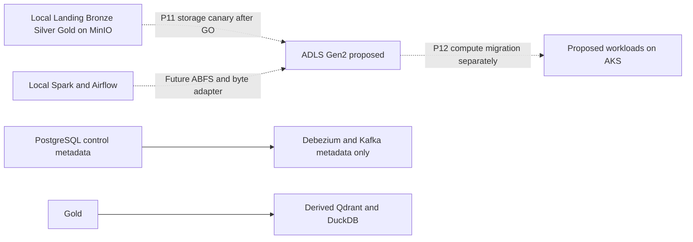

# Kiến trúc Azure dự kiến — bản thiết kế Phase10

Khởi tạo 22/10, cập nhật 23/10/2026. **Future Work / DRAFT — chưa được owner sign-off**.
Không có Azure login, tài nguyên, migration hoặc IaC apply trong Phase10.
Gate hiện tại NO-GO; bản thiết kế chỉ làm rõ phạm vi cho review.

## Ranh giới và thứ tự

| Thành phần | Đang có local | Phạm vi tương lai |
|---|---|---|
| Durable object store | MinIO/S3A, immutable Landing/Bronze, Delta Silver/Gold, Parquet/manifest | P11 chỉ storage canary ADLS sau GO |
| Transformation | Spark 3.5.3, Delta 3.2.1, Hadoop AWS 3.3.4 | Giữ contract/semantics; bổ sung compatible ABFS runtime ở P11 |
| Orchestrator/compute | Airflow 2.11.2 LocalExecutor, Docker Spark | P11 vẫn local; P12 mới đánh giá AKS/deployment |
| Operational state | PostgreSQL `pipeline_operations`, `crawler_operations` | Không migrate cùng storage canary; giữ consistent checkpoint/lineage |
| Control CDC | Hai bảng `control_metadata` → Debezium/Kafka | Giữ metadata-only; migration runtime riêng ở P12 |
| Serving | Source-scoped Qdrant và DuckDB files | Rebuild từ đúng Gold/manifest; không coi serving là durable truth |
| Registry/secrets/observability | Local images/env/Prometheus/Grafana | ACR, Key Vault/identity và P12 monitoring là đề xuất chưa provision |

Implementation boundary: `src/news_pipeline/{config,storage,spark_storage}.py`.
Profile `abfss://` resolve được, nhưng byte factory và Spark adapter cố ý fail-fast
với ADLS. Không chỉ đổi URI là có cloud execution; cần adapter test riêng và
ABFS authentication/classpath/Delta log-store canary.

## Quyết định thiết kế còn mở

Đề xuất GPv2 với HNS cho đường dữ liệu phân tầng. HNS cung cấp directory semantics
và thao tác directory atomic, nhưng sau khi bật không chuyển lại flat namespace;
cần review compatibility, region/SKU và nhu cầu trước tạo account.
[Microsoft HNS](https://learn.microsoft.com/en-us/azure/storage/blobs/data-lake-storage-namespace).

IAM/network/cost/backup chưa được người có quyền review. Đọc
[ADLS preflight](adls-gen2-migration-preflight.md),
[identity matrix](identity-access-matrix.md),
[network/cost/rollback](cloud-network-cost-rollback-plan.md) và
[entry checklist](phase11-entry-checklist.md). Không tự chọn subscription, account,
region, quota, ngân sách, retention hoặc SLO đạt được.
