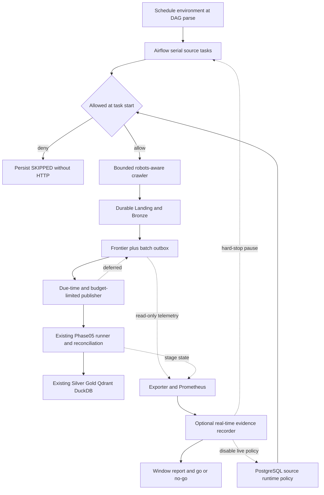

# Phase09 — Vận hành crawler local theo lịch và bằng chứng burn-in

Ngày thực hiện: **22/10/2026**, timezone hiển thị `Asia/Ho_Chi_Minh`; timestamps máy đọc trong evidence dùng UTC. Branch `feat/Phase-9`, base `583a382`. Phạm vi local, không commit/push/merge/rebase hoặc triển khai cloud.

**Trạng thái đã kiểm chứng:** implementation chức năng **PASS** theo full-run cộng focused recheck sau sửa rollback (chín checkpoint, từng checkpoint exit 0). Burn-in 24h: **PENDING**; 72h: **PENDING**; toàn Phase09 **chưa DONE**. Không chuyển sang Phase10 hoặc đổi cloud verdict.

## CP0 — Preflight và sai khác với handover

Đã đọc specification Phase09, AGENTS, contracts/profile, trạng thái và các nhiệm vụ/implementation trước. Không có `CHAT_CONTEXT_HANDOVER_LATEST.md`; Phase01 task thực tế tên `01_bronze_silver_local.md`. Phase08 đã commit/merge trong history; working tree ban đầu chỉ có Phase09 specification chưa track, không còn trạng thái 15 modified/58 untracked của ngày 03/10.

Docker/Compose có sẵn; ban đầu stack dự án dừng, một PostgreSQL của project khác được giữ nguyên. `make phase8-acceptance` ban đầu exit **2** do PostgreSQL DNS chưa sẵn sàng. `make bootstrap` lần đầu exit **2** do thiếu `METADATA_CDC_PASSWORD`. Đã tạo giá trị local còn thiếu trong `.env` ignored để bootstrap cấu hình role CDC local, không in giá trị; bootstrap lần sau exit **0**, `crawler-init` exit **0**, giữ toàn bộ volumes. Không thực hiện rotation/revocation API credentials hoặc remediation lịch sử Git.

Baseline sau khởi động qua 26 crawler tests nhưng E2E exit **2**: fixture frontier vẫn có `first_seen_at` ngày 03/10, quá cửa sổ recheck bảy ngày ở ngày 22/10. Đã sửa đúng bước khởi tạo namespace `fixture-acceptance` để làm mới thời điểm discovery. Không thay SQL eligibility hoặc timestamp của live frontier để ép test PASS.

Lượt functional acceptance đầu đi qua Phase08/05; phần core monitoring/failure-recovery Phase07 PASS, nhưng target Phase07 exit **2** ở CI selection vì release unit test vẫn yêu cầu wording “Phase 08” cho ADLS deferred adapter. Đã thay assertion bằng capability boundary và kiểm thêm Spark ADLS fail-fast, bỏ phase-number wording lỗi thời trong error message. Không thêm ADLS execution. Logs/verdict FAIL của lượt đầu được giữ tại `artifacts/phase9/attempt-1/`; lượt kiểm chứng cuối báo riêng.

Security audit CLI exit **0** nhưng JSON verdict **FAIL** vì historical credential names; cloud vẫn **NOT READY FOR CLOUD MIGRATION**. Không in raw secret, sửa lịch sử Git hoặc gộp security remediation vào Phase09. Chi tiết và logs tại ignored `artifacts/phase9/preflight.md`, `preflight-results.json`, `baseline-retry-results.json` và các logs cùng thư mục.

Lượt acceptance tiếp theo qua toàn bộ regression Phase05/07/08, nhưng recovery drill exit **1** ở health probe: `airflow jobs check --allow-multiple` thiếu `--limit > 1` trên Airflow 2.11.2. Scheduler thực tế healthy sau restart. Đã sửa probe thành `--local` theo CLI help có sẵn và xác nhận exit **0**. Các logs/verdict trước sửa được giữ trong `artifacts/phase9/attempt-2/`; kết quả chạy lại được ghi riêng, không thay thất bại bằng suy đoán.

Post-rollback verification phát hiện lỗi khác trong safety drill ban đầu: sau hai successful cycles, cron một phút đã tạo run thứ ba trước lúc pause/recreate. Crawl tasks của run này vẫn SKIPPED; publish tasks sau đổi environment bị `Live DAG requires explicit opt-in`, run kết thúc FAILED. Do đó PASS ban đầu của drill chưa đủ để chốt functional gate. Đã lưu nguyên lượt full target trước đó cùng failed-history vào `attempt-3/`; không xóa hoặc sửa run FAILED trong Airflow. Sửa helper thành cron hai phút, pause ngay khi đủ cycles, kiểm queued/running trước recreate và kiểm toàn bộ lịch sử của window sau rollback. Chỉ chạy lại checkpoint scheduling bị ảnh hưởng; tám checkpoint đã PASS trước đó được giữ nguyên bằng chứng. Kết quả hợp nhất cuối và provenance được nêu bên dưới.


## CP1 — Chính sách nguồn, lịch và bảo vệ tải

Luồng dữ liệu giữ nguyên: source parser/adapter → Landing/Bronze → Phase05 runner → Silver/Gold → Qdrant/DuckDB. Kafka vẫn chỉ CDC hai bảng control metadata. ViFinNER, canonical contracts, chunking/embedding và các transformation không được thiết kế lại.

| Thay đổi | Code/config | Quyết định và tác động |
|---|---|---|
| Runtime policy | `src/crawling/policy.py`, `state.py` | Reuse `config.crawler`; source enabled/live flags, HTTP/batch/retry bounds, fail-closed live default |
| Schedule/manual separation | `airflow/dags/news_crawling_pipeline.py`, `src/crawling/airflow_jobs.py` | Schedule từ env lúc parse; source policy đọc khi task chạy. Manual luôn mặc định fixture, kể cả lúc bật lịch live |
| Recurring batch limit | `.env.example`, Compose | `AIRFLOW_NEWS_CRAWLER_LIMIT`, effective cap còn bị giới hạn bởi source `max_articles` |
| Skip và block latch | Migration `0003_continuous_crawling`, `state.py` | Operational `SKIPPED`/`SCHEDULED`; 401/403/challenge/robots latch cần review trước retry |
| Persisted replay attempts | Cùng migration, `jobs.publish` | RUNNING/FAILED, eligibility/backoff/jitter/budget; interrupted publisher được lock holder tiếp theo reclaim |
| Thin orchestration | DAG/CLI adapters | `publish` dùng `all_done` để thử backlog dù fetch thất bại; source disablement vẫn được tôn trọng |

Schema migration chỉ thêm trạng thái vận hành, không capture thêm bảng vào CDC. Downgrade từ chối khi còn rows không biểu diễn được theo enum cũ; không xóa lịch sử để làm rollback trông như thành công. Manual publisher là thao tác replay chủ đích có cap; tự động/DAG tôn trọng due time/budget, CLI có `--respect-retry` khi muốn dùng cùng điều kiện.

Kiểm chứng checkpoint ban đầu: **44 tests PASS**, exit **0** (26 crawler cũ, 12 policy/report unit, sáu PostgreSQL integration). **10 DAG tests PASS**, exit **0**, gồm schedule on/off, invalid opt-in và manual fixture safety. Những tests PostgreSQL mô phỏng runner chứng minh state/attempt/cap; không tự nhận chúng là thực nghiệm Spark/serving đầy đủ.

## CP2 — Quan sát, reporting và phục hồi

`jobs.py` ghi structured outcomes, source/run context và completion timestamps cho Landing. Metrics phân biệt fetch failure, blocked/rate-limited, parser failure, new/update/unchanged và skip. HTTP 200 thiếu body/title có raw Landing evidence và parser failure; timestamp optional vẫn nullable, không tự bịa publication date.

`src/monitoring/crawler_metrics.py` mở rộng exporter read-only: completed heartbeat, durable Landing, linked layer freshness, Landing-to-layer interval, oldest pending, outbox states/exhausted budgets và runtime live policy. Labels thêm `layer` với tập hữu hạn; không URL/article/run IDs. Totals tiếp tục là gauge từ state bền vững theo convention hiện có, không giả định in-process counters sống qua mọi crash. Các request của process chết trước khi metrics được persist có thể thiếu trong tổng. HTTP elapsed đo request chain sau initial wait; redirect pacing nằm trong chain, nên không gọi đó là pure network I/O latency.

Dashboard crawler được mở rộng tại cùng UID `news-crawler`; repository vẫn provision **bảy dashboard**, không thêm bản sao. API Grafana tại workspace trả tám dashboard vì còn `Financial News Platform` (UID `cfztyb3sdimm8d`) ngoài tập UID provisioned; dashboard lưu sẵn này được giữ nguyên. Bốn rules bổ sung đưa cấu hình lên **19 rules**: parser/discovery success có sample floor, retry exhaustion, oldest pending và enabled-source heartbeat. Block alert còn đọc latch hiện tại, không chỉ sự kiện trong cửa sổ 15 phút. Ngưỡng local có thể chỉnh, chưa phải SLO đo được. Kiểm tra `promtool` synthetic inputs xác minh firing/resolution; đó không phải cố tình gây tải lên website.

Empty-discovery warning dùng ba lần trong hai giờ để có thể phát hiện ở cadence đề xuất 30 phút. Rà soát đã sửa cửa sổ một giờ vốn không đủ chỗ cho ba increments cách nhau 30 phút; test cadence thực tế này xác minh chưa firing ở phút 50, firing ở phút 100 và resolved ở phút 245, exit **0** (`alert-tests-cadence.log`). Các phút này là timeline synthetic của rule test, không phải thời lượng vận hành thực tế.

`src/crawling/reporting.py` tổng hợp cửa sổ đóng: cohort runs, scheduled IDs không nhân theo retry, pending-at-end từ created/published timestamps, stage-linked freshness và latency. Mẫu latency là **batch/stage**, từ first durable HTML Landing đến successful completion, không phải article-publication-to-serving hoặc user latency. p95 N/A dưới 20 samples; missing historical timestamps không bị thay bằng thời gian suy đoán. Host tool thêm actual Prometheus alert history; storage sampling có page budget, completeness flag và PostgreSQL relation sizes.

`tools/phase9.py` cung cấp config/report/functional acceptance và recorder/gate burn-in. Recorder không crawl bằng loop riêng; Airflow vẫn là scheduler. Nó lưu boot ID, UTC/monotonic time, sample gaps, service/resource/storage state và report; stop/pause khi hard-stop hoặc kết thúc window. Unit tests dùng thời gian tổng hợp chỉ kiểm thuật toán gate, không tạo chứng cứ 24h/72h.



Sơ đồ mô tả code paths, không là bằng chứng recorder đã chạy đủ một window. Implementation references: `airflow/dags/news_crawling_pipeline.py`, `src/crawling/{policy,jobs,state,reporting,burnin,operations}.py`, `src/monitoring/crawler_metrics.py`, `tools/phase9.py`. Data plane và metadata CDC tiếp tục là các thành phần hiện hữu.

Các kiểm tra CP2 ban đầu: **tám metrics tests PASS**; **18 policy/report/burn-in unit tests PASS**; `promtool test rules` exit **0**. Báo cáo fixture qua database/Prometheus thực đã xuất được. Kết quả functional regression tổng hợp và các drill scheduler/restart nằm ở mục kiểm chứng cuối bên dưới.

Quan sát mới ngày 22/10: inventory từ Prometheus/Grafana thực xác nhận **19 rules, 14 panel crawler, bảy dashboard provisioned cộng một dashboard lưu sẵn**, labels không vượt tập cho phép. `collector-probe.json` đọc được database, storage năm nguồn, lịch Airflow, sáu target dịch vụ và CPU/RAM/disk; không có collection error/hard-stop. Đây là một read-only smoke, không phải session burn-in. `database-invariants.json` xác nhận đủ ba operations migrations và publication vẫn chỉ gồm `control_metadata.news_sources`, `control_metadata.pipeline_configs`.

Regression fixture năm nguồn có một bài được fetch/nguồn, mỗi projection nguồn có **một Silver article, một Gold document/chunk, một Qdrant point và một DuckDB article**, reconciliation PASS ở cả năm nguồn. Đây là fixture tổng hợp và store local đã có dữ liệu: một observation mới trong namespace frontier test có thể là no-op ở Silver. Không diễn giải thành năm bài live mới hoặc chất lượng retrieval. Evidence gốc của lần chạy mới được lưu riêng dưới `artifacts/phase9/regression-evidence/` khi kết thúc để giữ các artifact Phase08 đã commit ở snapshot lịch sử của chúng.

Hai báo cáo cho cùng cửa sổ đóng 21/10 theo `Asia/Ho_Chi_Minh` đã xuất được riêng tên `*-live.json`, `*-fixture.json`, tránh ghi đè giữa hai phạm vi. Cửa sổ đó thiếu dữ liệu Prometheus nên `alert_history_coverage.complete=false`; một alert list rỗng không được dùng làm bằng chứng không có sự cố. CPU sampler đo tỷ lệ busy trung bình năm phút của workstation dùng chung, không phải benchmark pipeline. Các report định kỳ mới và file collector giữ rõ scope/sampling gap.

## Entrypoints và evidence

```sh
make phase9-config-check
make phase9-acceptance
make phase9-daily-report
make phase9-burnin-report
python3 tools/phase9_recovery.py
python3 tools/phase9_scheduler_smoke.py
```

Các file runtime nằm trong ignored `artifacts/phase9/`; raw HTML và serving files tiếp tục nằm trong MinIO/ignored `data/local`. `docs/crawler-operations.md` là runbook enable/pause/rollback, source policy, retry, drift triage, reports và real-time collection. Các Make targets không tự ngủ 24/72 giờ trong CI hoặc tự bật source live.

## CP3–CP4 — Burn-in theo thời gian thực

Chưa có session 24h hoặc 72h hoàn tất trong lượt implementation này. Không dùng các counts/durations fixture hoặc smoke ngày 03/10 để thay thế. B1 live cycles và B2/B3 cần current source policy/access review, source opt-in, môi trường healthy, backup/recovery reference và workstation/collector thực sự hoạt động suốt window.

Drill hai phút với live policies bị khóa chỉ kiểm cơ chế scheduler/skip và rollback. Nó không chứng minh 30-minute live cadence, throughput, nguồn tin đầy đủ hoặc độ bền multi-day. `burnin-start` kiểm functional gate, policy review record, scheduler/telemetry và reference tồn tại. Reference là bằng chứng/plan do người vận hành cung cấp; tool không tự xác nhận backup đã restore thành công chỉ vì có một đường dẫn.

24h report phải có đủ elapsed UTC và monotonic duration, boot ổn định, coverage không có gap lớn, actual scheduled histories và source live successes. Failed/partial/reconciliation/backlog chưa được giải quyết ngăn automatic PASS. 72h chỉ được bắt đầu sau report 24h PASS và go/no-go review. Chi tiết tại `artifacts/phase9/burnin-24h.md`, `burnin-72h.md`; hiện là **PENDING**, không phải kết quả thực nghiệm.

## Hạn chế và handoff

- Pacing, retries và source advisory lock phù hợp local; chưa có distributed/global request budget hoặc proof cho mọi crash boundary.
- Phase05 cross-store publication/checkpoint limitations vẫn còn; Phase09 không tuyên bố exactly-once hoặc commit nguyên tử mọi store.
- Backfill newest-observation conflict, retention/archive, canonical richer metadata, NER, unified serving, cloud và RAG evaluation không thuộc implementation này.
- Storage snapshots là quan sát định kỳ; truncated listing là lower bound. Same-host Bronze bao gồm cả dữ liệu lịch sử/fixture. Resource metrics là máy phát triển dùng chung.
- Collector bị SIGKILL/power loss không thể chạy kill-switch; sau restart cần pause ngay và không coi window đứt quãng là unattended PASS.
- S3 HTTP 400 lịch sử chưa có root cause. Khi tái diễn phải giữ timestamp, stage/error log và request context có sẵn; không sửa transformation theo giả thuyết chưa kiểm chứng.
- Historical secret gate chưa được giải quyết. Chỉ xem Phase10/security readiness sau khi các gates thực sự đạt; không tự chuyển phase.

## Kết quả kiểm chứng cuối và acceptance matrix

**Functional verification hợp nhất PASS**, chín checkpoint đều có exit **0**. Full `make phase9-acceptance` từng exit 0 trong cửa sổ **12:49:42–13:17:38 UTC**, nhưng post-rollback check sau đó phát hiện extra failed cycle nên kết quả scheduling đó chưa được chấp nhận. Đã giữ tám checkpoint không bị ảnh hưởng, sửa helper và chạy lại `python3 tools/phase9_scheduler_smoke.py`, **exit 0**, hoàn tất **2026-10-22T13:27:41.589002+00:00**. Không chạy lại toàn bộ Spark regressions cho sửa teardown này. Đây là provenance của bộ kiểm chứng hợp nhất, không phải tuyên bố có một lượt full Make mới sau bản sửa. Args/timestamps của từng checkpoint và đường dẫn lượt bị thay thế nằm trong `artifacts/phase9/acceptance.json`; human summary tại `acceptance-summary.md`.

| Checkpoint | Exit code | Log |
|---|---:|---|
| `config` | 0 | `artifacts/phase9/config.log` |
| `phase9-tests` | 0 | `artifacts/phase9/phase9-tests.log` |
| `metrics-tests` | 0 | `artifacts/phase9/metrics-tests.log` |
| `alert-tests` | 0 | `artifacts/phase9/alert-tests.log` |
| `phase8-regression` | 0 | `artifacts/phase9/phase8-regression.log` |
| `phase5-regression` | 0 | `artifacts/phase9/phase5-regression.log` |
| `phase7-regression` | 0 | `artifacts/phase9/phase7-regression.log` |
| `restart-recovery` | 0 | `artifacts/phase9/restart-recovery.log` |
| `scheduler-smoke` | 0 | `artifacts/phase9/scheduler-smoke.log` |

Suite Phase09 gồm **54 tests PASS**: 13 policy/report unit, tám PostgreSQL integration, bảy unit kiểm thuật toán burn-in và 26 crawler tests cũ. **10 metrics tests PASS**, **10 DAG tests PASS** trong Phase08 regression; năm synthetic alert scenarios qua `promtool`. Kiểm tra cadence 30 phút được chạy bổ sung sau điều chỉnh rule window, exit **0**; rule thực tế đã reload và kiểm tra qua Prometheus API. Không cần chạy lại Spark regressions cho thay đổi cửa sổ alert.

Drill restart dùng một batch fixture VnExpress: Qdrant endpoint lỗi → outbox FAILED, restart scheduler thật → process mới resume. Bronze/Silver/Gold giữ attempt **1**; Qdrant lần **1 FAILED**, lần **2 SUCCESS**; reconciliation **PASS**. Số crawl run không tăng trong thao tác replay. Sau assertion, drill dùng fixture transport để trả projection về body gốc; không có website refetch thật. `restart-recovery.json` lưu stage/attempt và counts. Checkpoint fixture chưa hoàn tất của lượt probe lỗi trước vẫn được lưu riêng trong `attempt-2/recovery-state.json`; không nhận PASS của drill mới là toàn bộ backlog fixture lịch sử đã sạch.

Drill scheduler đã sửa quan sát hai actual scheduled DAG runs, lần lượt **13:24:25–13:24:54 UTC** và **13:26:00–13:26:27 UTC** ngày 22/10, với cron tạm hai phút. Sau rollback không còn queued/running cycle; cả hai run trong window này giữ SUCCESS. Mỗi nguồn có hai `SKIPPED/source_live_disabled`, tổng request count **0**, không overlap, `max_active_runs=1`, `max_active_tasks=1`. Sau drill đã xác minh `schedule=None`, scheduled live switch **false**, cả năm source live policies **false**. Evidence: `scheduler-smoke.json`, `restored-config.json`. Đây là scheduling safety proof; **B1 live cycles vẫn PENDING**.

| ID | Kết quả | Phạm vi bằng chứng |
|---|---|---|
| A01 | PASS | Preflight, Git baseline, Phase08 regression exit 0; lỗi môi trường/fixture ban đầu được giữ log |
| A02 | PASS | Default/manual fixture, fail-closed live policy, on/off DAG tests |
| A03 | PASS phạm vi deterministic | Manual fixture E2E và live opt-in gate; không tuyên bố đã smoke website lại ngày 22/10 |
| A04 | PASS | DAG limits và hai real scheduled cycles bị policy deny, không overlap |
| A05 | PASS | PostgreSQL fixture source disablement/isolation, independent DAG groups |
| A06 | PASS | New/unchanged/update và Phase05/08 reconciliation; raw/outbox assertions |
| A07 | PASS | HTTP 200 invalid body, 403/429/cooldown, empty discovery và parser classification |
| A08 | PASS phạm vi drills | Bounded replay/backoff tests; actual fixture serving outage/restart/resume và Phase07 fault tests |
| A09 | PASS phạm vi instrumentation | Exporter/DB/Prometheus/Grafana, collector read-only smoke; chưa có resource-growth series multi-day |
| A10 | PASS | Synthetic firing/resolution, gồm empty discovery ở cadence 30 phút; thresholds chưa được hiệu chỉnh bằng burn-in |
| A11 | PENDING | Chưa có 24 giờ real elapsed live collection |
| A12 | PENDING | Chưa có 72 giờ real elapsed sau go/no-go 24h |
| A13 | PASS | Phase05, Phase07, Phase08 targets đều exit 0 |
| A14 | Đạt phạm vi thay đổi local; security gate FAIL | Không thêm cloud/commit/raw artifact; historical credential remediation chưa thực hiện |
| A15 | Tài liệu/tooling sẵn sàng; phase close-out PENDING | Runbook, reports, Make entrypoints và pending burn-in artifacts; chưa chuyển Phase10 |

Ruff check **24 Python files PASS**, exit **0**; format check **21 files PASS**, exit **0**. Ba file sửa ít dòng có format chưa đạt từ HEAD (`spark_storage.py`, DAG tests, release unit tests) được ghi trong `format-baseline.json`, giữ nguyên style hiện hữu để tránh refactor ngoài phạm vi. Không tuyên bố toàn repository đã qua formatter. Kiểm tra local links/headings/fences trong bảy tài liệu và `git diff --check` được lưu riêng khi chốt documentation.

Các runtime artifact Phase05/08 vốn đã track và bytecode bị tests cập nhật đã được copy vào `artifacts/phase9/regression-evidence/<original-path>`, rồi trả đúng bytes của HEAD. Chỉ khôi phục các file ban đầu sạch và do quá trình kiểm thử tạo thay đổi; không khôi phục code/tài liệu đang triển khai hoặc specification của người dùng. Manifest: `runtime-artifact-restoration.json`. Evidence mới vẫn còn đầy đủ trong ignored `artifacts/phase9/`; không có Git commit/push, cloud resource hoặc history rewrite.

**Phần còn lại:** review access/policy nguồn hiện tại; xác định và kiểm chứng backup/restore; B1 controlled live cycles; B2 24h thật; đánh giá incidents/resource growth/ngưỡng; rồi B3 72h thật. Actual burn-in start/end và live volume của các window này đều **N/A — NOT STARTED**. CP0–CP2 đạt phạm vi functional; CP3–CP4 và phase-level CP5 close-out còn **PENDING**. Historical security workstream giữ cloud verdict **NOT READY FOR CLOUD MIGRATION**.

## Đồng bộ tài liệu sau merge — 22/10/2026

Lượt rà soát tài liệu bắt đầu tại `8bd1f7e`; branch/base ở đầu báo cáo mô tả
phiên implementation gốc. README, architecture/operations, demo, các tài liệu
release/cloud và bộ báo cáo luận văn đã được đối chiếu với source Phase09.
Danh sách claim được sửa và kiểm tra nằm trong
[báo cáo rà soát tài liệu](phase9-documentation-review.md). Không thực thi lại
acceptance, bật lịch hoặc crawl website ở lượt này; không tạo kết quả performance
mới. Functional/burn-in/security verdict và failure provenance ở trên giữ nguyên.
